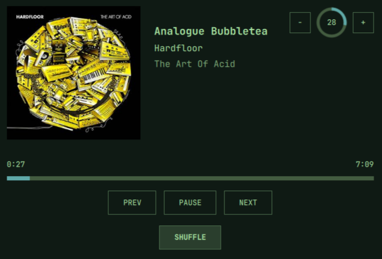

# Volumio Control

A minimal Omarchy Quattro plugin for Volumio players on the local LAN.

It discovers `_Volumio._tcp` services with `avahi-browse`, reads playback state from the Volumio HTTP API, and provides track metadata, progress, play/pause, and volume controls. The Music menu browses Volumio sources, navigates folders and albums, searches, and plays or queues playable results.

## Requirements

- Omarchy Quattro with the plugin directory enabled
- `avahi-browse` and `curl`

## Screenshot


## Install

```sh
omarchy plugin validate ~/.config/omarchy/plugins/volumio_ctrl
omarchy plugin enable volumio_ctrl
```

Add `volumio_ctrl` to the bar layout. Discovery runs when the service initializes. Multiple players can be selected from the panel.

The bar widget uses the Volumio artwork as a small monochrome icon, tinted to
the active bar foreground color.

The Music menu also provides **UPDATE** and **RESCAN** actions. They use
Volumio's Socket.IO API: Update incrementally updates the MPD database (and
uses the currently browsed library path when applicable), while Rescan
rebuilds the database. These actions require Python 3 in addition to the
requirements above.
